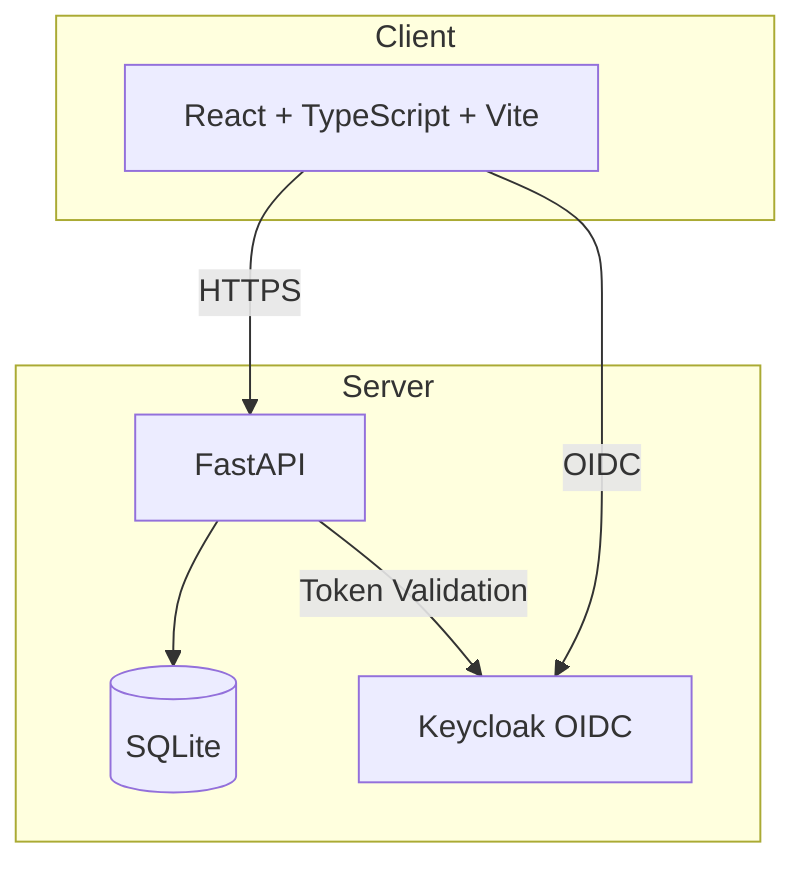

# vector-studio — Self-hosted Gym & Body-weight Tracker — Ryan Vo

> Work in progress. This checkpoint may be incomplete or fail tests. See PLAN.md and STATUS.md before use.


**Ryan Vo | AI & Machine Learning** — ryandtvo@gmail.com

---

## Overview

vector-studio is a self-hosted gym and body-weight tracker for planning routines, logging workouts (supersets, warm-ups, cardio), and visualizing which muscles are trained, fatigued, or detraining. Import from FitNotes, Strong, or Hevy. Your data stays on your server.

## Features

- **Routine Management** — Create, edit, and organize workout routines with phases (mobility, work, accessory, cooldown)
- **Workout Logging** — Log sets with weight, reps, RPE; track warm-up vs work sets
- **Exercise Catalogue** — 50+ exercises with muscle mapping, equipment, and instructions
- **Import/Export** — Import from FitNotes CSV, Strong CSV, and Hevy JSON
- **Muscle Fatigue Tracking** — Per-muscle fatigue calculation and detraining timeline
- **OIDC Authentication** — Keycloak with passkey/WebAuthn support
- **Optional AI Coach** — Generate routines and propose adjustments via LLM (provider-agnostic)

## Quick Start

### Prerequisites

- Docker & Docker Compose
- Node 24+ (for local frontend development)
- Python 3.12+ (for local backend development)

### Using Docker Compose (Recommended)

```bash
# Clone and navigate
cd vector-studio-144-ryan-vo

# Copy environment template
cp .env.example .env

# Start all services
docker compose up -d

# Access the application
# Frontend: http://localhost:8080
# Backend API: http://localhost:8000
# API Docs: http://localhost:8000/api/docs
# Keycloak: http://localhost:8081 (admin/admin)
```

### Local Development

#### Backend

```bash
cd backend
python -m venv .venv
.venv/bin/pip install -r requirements.txt
.venv/bin/uvicorn app.main:app --reload --host 0.0.0.0 --port 8000
```

#### Frontend

```bash
cd frontend
npm install
npm run dev
```

## Architecture



## API Reference

### Health

- `GET /api/health` — Application health
- `GET /api/health/db` — Database connectivity

### Routines (Planned)

- `GET /api/routines` — List routines
- `POST /api/routines` — Create routine
- `GET /api/routines/{id}` — Get routine
- `PATCH /api/routines/{id}` — Update routine
- `DELETE /api/routines/{id}` — Delete routine

### Workouts (Planned)

- `GET /api/workouts` — List workout sessions
- `POST /api/workouts` — Start workout
- `POST /api/workouts/{id}/entries` — Log exercise entry
- `POST /api/workouts/{id}/complete` — Complete workout

### Exercises (Planned)

- `GET /api/exercises` — Search exercises
- `GET /api/exercises/{id}` — Get exercise details

## Configuration

| Variable | Description | Default |
|----------|-------------|---------|
| `DATABASE_URL` | SQLite connection string | `sqlite+aiosqlite:///./data/app.db` |
| `SECRET_KEY` | JWT signing key (32+ chars) | Required |
| `OIDC_ISSUER_URL` | Keycloak realm URL | `http://localhost:8081/realms/vector-studio` |
| `OIDC_CLIENT_ID` | Keycloak client ID | `vector-studio-frontend` |
| `OIDC_CLIENT_SECRET` | Keycloak client secret | Required for confidential clients |
| `LLM_PROVIDER` | LLM provider (openai, anthropic, gemini, ollama) | Optional |
| `LLM_MODEL` | Model name | Optional |
| `LLM_API_KEY` | Provider API key | Optional |
| `LLM_BASE_URL` | Custom base URL (e.g., Ollama) | Optional |

## LLM Provider Setup

The AI Coach is optional and works without any LLM key. When configured, it supports:

- **OpenAI-compatible** (OpenAI, LiteLLM, OpenRouter, Ollama) — `LLM_PROVIDER=openai-compatible`
- **Anthropic** — `LLM_PROVIDER=anthropic`
- **Gemini** — `LLM_PROVIDER=gemini`
- **Ollama** — `LLM_PROVIDER=ollama`, `LLM_BASE_URL=http://host:11434`

All LLM calls are server-side only. Keys never reach the browser.

## Keycloak / SAML Setup

Keycloak runs with a pre-configured realm (`vector-studio`) supporting:

- Authorization Code flow with PKCE
- Passkey/WebAuthn registration (platform authenticator)
- Roles: `user`, `admin`

### SAML Identity Provider Brokering

1. In Keycloak Admin Console: **Identity Providers → Add SAML v2.0**
2. Configure IdP metadata or URL
3. Map SAML attributes to Keycloak attributes
4. Enable **First Login Flow** for user linking

## Backup & Restore

```bash
# Backup SQLite database
docker compose exec backend cp /app/data/app.db /app/data/app.db.backup

# Restore
docker compose exec backend cp /app/data/app.db.backup /app/data/app.db
```

For production, use PostgreSQL with proper backup strategy.

## Security Limitations

- Demo mode binds to `127.0.0.1` only; refuses to start in production without proper TLS
- SQLite is for development; use PostgreSQL for production
- Change all default secrets before exposing to network
- Passkeys require HTTPS (or localhost)
- No rate limiting implemented yet

## Development

### Running Tests

```bash
# Backend
cd backend
.venv/bin/python -m pytest

# Frontend
cd frontend
npm test
```

### Code Style

- Backend: Ruff (lint), Black (format) — not yet configured
- Frontend: ESLint, TypeScript strict mode

## License

MIT License — Copyright (c) 2026 Ryan Vo <ryandtvo@gmail.com>

See [LICENSE](LICENSE) for details.